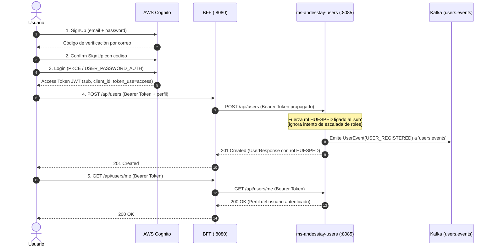

# ms-andesstay-users

Microservicio de dominio del caso **AndesStay** (DSY1107 - Desarrollo Cloud Native I, Duoc UC).

Responsable del dominio **Usuarios**: registro, perfil, **roles** y baja lógica de usuarios. Las credenciales las administra **AWS Cognito**; este servicio almacena el perfil de negocio, emite eventos de ciclo de vida de usuario a Apache Kafka y mantiene los roles sincronizados con los **grupos de Cognito**.

---

## Stack Tecnológico

- **Java 17** · **Spring Boot 3.3.4** (Web, Data JPA, Validation, Security, Actuator, Kafka)
- **Spring Security OAuth2 Resource Server** (JWT - AWS Cognito User Pool `us-east-1_l3aNhIuac`)
- **Apache Kafka** (integración a clúster compartido de 2 brokers, tópico `users.events`)
- **AWS SDK v2** (`cognitoidentityprovider`) para sincronización de grupos y administración (opcional)
- **PostgreSQL 16** · **Docker Compose** · **Maven 3.9+** · **springdoc-openapi** (Swagger)

Convenciones compartidas con `ms-andesstay-catalog` y `ms-andesstay-reservations`:
- Paquete base `cl.duoc.andesstay.users`.
- Capas: `controller → service → repository`, `model`, `dto`, `security`, `config`, `consumer`, `producer`, `idp`.
- `ErrorResponse` estandarizado: `{ "timestamp", "status", "error", "message", "path" }`.
- `TraceIdFilter` (`X-Trace-Id` en cabeceras y MDC de logging).
- Validación de token JWT con 3 validadores: issuer uri, `client_id` (`andesstay-web`) y `token_use=access`.

---

## Arquitectura y Red

```
                     ┌────────────────────────────────────────┐
                     │          AWS Cognito User Pool         │
                     │ (us-east-1_l3aNhIuac / andesstay-web)  │
                     └──────────────────┬─────────────────────┘
                                        │ JWT Access Token
                                        ▼
Cliente / Angular ──────────► ms-andesstay-bff (:8080)
                                        │ Bearer Token propagado
                                        ▼
                             ms-andesstay-users (:8085)
                                  │                │
            JDBC (:5432)          │                │ Producer (users.events)
                                  ▼                ▼
                     PostgreSQL (host :5435)   Kafka Cluster (2 brokers)
                     (DB: andesstay_users)     (kafka-1:29092, kafka-2:29093)
                                               [Red Docker: andesstay-net]
```

### Separación de Tópicos Kafka (Entrega 3)
- **`users.events`**: Tópico dedicado para eventos del ciclo de vida de usuarios (`UserEvent`: `USER_REGISTERED`, `USER_UPDATED`, `USER_ROLE_CHANGED`, `USER_DEACTIVATED`).
  - **Factor de replicación**: Configurable vía variable de entorno (`KAFKA_TOPIC_REPLICATION_FACTOR=2` en local y AWS).
  - **Consumer Group**: `users-events-group` (independiente).
  - **Aislamiento**: `UserEvent` **no** se publica en `reporteria-eventos`. De esta forma, el consumidor de `ms-andesstay-reservations` (que espera el esquema `ReportEventMessage`) no sufre fallos de deserialización y ningún evento de users es desviado a `reporteria-eventos.DLT`.
- **Endpoints de Reportería y Kafka Admin**: Centralizados exclusivamente en `ms-andesstay-reservations` (`/api/admin/kafka/**` y `/api/reportes/**`), que es desde donde lee Grafana y los dashboards KPI.

---

## Flujo de Registro y Autenticación

El alta de usuarios y su vinculación con el microservicio sigue el siguiente flujo de 5 pasos:



> [!NOTE]
> **Alineación con el BFF**: En versiones preliminares, el Javadoc de `UsersProxyController` en el BFF indicaba erróneamente que `POST /api/users` era un endpoint público. En realidad, el endpoint está protegido (`authenticated`) tanto en el `SecurityConfig` del BFF como en `ms-andesstay-users`: el usuario debe autenticarse primero en Cognito y enviar el Bearer token para registrar su perfil local vinculado al `sub`.

---

## Matriz de Roles y API REST

### Roles de Usuario
| Rol | Grupo Cognito | Descripción |
|---|---|---|
| `HUESPED` | `HUESPED` | Cliente final del sistema. Rol asignado por defecto en auto-registro |
| `RECEPCIONISTA` | `RECEPCIONISTA` | Personal administrativo de atención y reservas |
| `ADMIN` | `ADMIN` | Administrador total del sistema (catálogo, reservas, usuarios) |
| `AUDITOR` | `AUDITOR` | Consulta trazas y eventos de auditoría |

### Endpoints (`/api/users`)

| Método | Ruta | Acceso requerido | Descripción y Reglas de Negocio |
|---|---|---|---|
| `POST` | `/api/users` | Autenticado | **Auto-registro**: Asigna forzosamente rol `HUESPED` y liga al `sub` del token (ignora `roles`/`password` del body).<br/>**Alta por ADMIN**: Permite crear usuarios con roles específicos y contraseña temporal. Retorna `201`. Si email o sub ya existen retorna `409`. |
| `GET` | `/api/users/me` | Autenticado | Retorna el perfil del usuario autenticado según su `sub`. `404` si aún no registra perfil. Si fue pre-creado por un ADMIN, vincula el `sub` automáticamente. |
| `GET` | `/api/users` | Solo `ADMIN` | Listado paginado de usuarios. Parámetros opcionales: `rol`, `estado`, `q`, `page` (def 0), `size` (def 50, máx 200). Retorna total en cabecera `X-Total-Count`. |
| `GET` | `/api/users/{id}` | `ADMIN` o Dueño | Consulta de detalle por UUID de usuario. |
| `PUT` | `/api/users/{id}` | `ADMIN` o Dueño | Actualización de perfil (nombre, apellido, teléfono). `roles` y `estado` solo pueden ser alterados por un `ADMIN` (si no, `403`). |
| `DELETE` | `/api/users/{id}` | Solo `ADMIN` | **Baja lógica** (`INACTIVO`) y deshabilitación en Cognito. Idempotente (`204`). Un ADMIN no puede eliminarse a sí mismo ni dejar al sistema sin ningún ADMIN activo (`409`). |

---

## Variables de Entorno

| Variable | Descripción | Valor por defecto / Ejemplo |
|---|---|---|
| `SERVER_PORT` | Puerto HTTP del servicio | `8085` |
| `DB_URL` | URL de conexión PostgreSQL | `jdbc:postgresql://localhost:5432/andesstay_users` (o `postgres:5432` en docker) |
| `DB_USERNAME` | Usuario de PostgreSQL | `postgres` |
| `DB_PASSWORD` | Contraseña de PostgreSQL | `postgres` |
| `COGNITO_REGION` | Región AWS del User Pool | `us-east-1` |
| `COGNITO_USER_POOL_ID` | Identificador del User Pool | `us-east-1_l3aNhIuac` |
| `COGNITO_APP_CLIENT_ID` | Client ID de la aplicación | `andesstay-web` |
| `COGNITO_ADMIN_ENABLED` | Integración administrativa Cognito (`false` = auto-registro local) | `false` |
| `DEFAULT_ROLE` | Rol asignado cuando el token no tiene grupos | `HUESPED` |
| `KAFKA_BOOTSTRAP_SERVERS` | Direcciones de los brokers Kafka | `kafka-1:29092,kafka-2:29093` (docker) / `localhost:9092,localhost:9093` (host) |
| `KAFKA_TOPIC_REPORTERIA` | Nombre del tópico para eventos de usuario | `users.events` |
| `KAFKA_CONSUMER_GROUP_ID` | Group ID del consumidor de eventos | `users-events-group` |
| `KAFKA_TOPIC_REPLICATION_FACTOR` | Factor de replicación del tópico | `2` (local y AWS) |
| `KAFKA_TOPIC_PARTITIONS` | Cantidad de particiones del tópico | `3` |
| `FRONTEND_URL` | Origen permitido para CORS (Angular) | `http://localhost:4200` |
| `CORS_ENABLED` | Habilitación de configuración CORS | `true` |

> [!IMPORTANT]
> **Modo Cognito Admin**: En entornos como **AWS Academy**, el rol de laboratorio no dispone de permisos `cognito-idp:Admin*`. Por ello, `COGNITO_ADMIN_ENABLED=false` viene configurado por defecto, permitiendo que el flujo opere de forma transparente mediante auto-registro y validación estándar de JWTs.

---

## Ejecución Local y Pruebas

### 1. Prerrequisito: Red externa compartida
Asegurar que la red Docker compartida exista:
```bash
docker network create andesstay-net
```

### 2. Infraestructura Kafka Compartida (2 brokers)
Desde `ms-andesstay-reservations/infra/kafka`:
```bash
docker compose up -d
```
Esto levanta Zookeeper, `kafka-1` (:9092 en host, :29092 en red) y `kafka-2` (:9093 en host, :29093 en red).

### 3. Levantar ms-andesstay-users
```bash
docker compose up -d --build
```
Servicios que levanta `ms-andesstay-users`:
- **`andesstay-users-db`**: PostgreSQL 16 expuesto en el puerto host `5435:5432` (evita conflicto con catálogo 5432 y reservaciones 5433).
- **`ms-andesstay-users`**: Aplicación Spring Boot en el puerto `8085:8085`, conectada a `andesstay-net`.

### 4. Verificación de Health y Endpoints

```bash
# 1. Healthcheck público
curl -i http://localhost:8085/actuator/health
# Esperado: 200 OK, {"status":"UP"}

# 2. Intento sin token a ruta protegida
curl -i http://localhost:8085/api/users/me
# Esperado: 401 Unauthorized

# 3. Consulta con token Cognito válido
curl -i -H "Authorization: Bearer <TOKEN_VALIDO>" http://localhost:8085/api/users/me
# Esperado: 200 OK con el perfil del usuario

# 4. Verificar que no existe tráfico erróneo en DLT
# En el cluster Kafka compartido, reporteria-eventos.DLT permanece limpio sin mensajes de users.
```

### 5. Ejecución de Tests
```bash
mvn clean test
```
Ejecuta la suite completa de 68 tests automatizados:
- `UserControllerSecurityTest`: Matriz de seguridad, 401 sin token, 403 por rol, 404 en rutas eliminadas y flujo integral de registro.
- `UserServiceTest`: Reglas de negocio (rol HUESPED forzado en auto-registro, protección del último ADMIN, compensación transaccional).
- `UserRepositoryTest`: Unicidad insensible a mayúsculas en PostgreSQL/H2 y consultas paginadas.
- `EventProducerTest`: Emisión de eventos al tópico `users.events` particionado por ID.
- `EventConsumerTest`: Deserialización y persistencia resiliente de eventos.
- `CognitoSecurityComponentsTest`: Validadores de audiencia, token_use e issuer.
